<div align="center">


<br />

<p align="center">
  <a href="https://m3.material.io/"></a>&nbsp;
  <a href="https://react.dev/">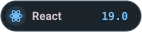</a>&nbsp;
  <a href="https://www.typescriptlang.org/"></a>&nbsp;
  <a href="https://vitejs.dev/"></a>&nbsp;
  <a href="#system-architecture"></a>&nbsp;
  <a href="#4-koda-webgl2-video-shader-studio--sponsorblock"></a>&nbsp;
  <a href="LICENSE"></a>
</p>

<p align="center">
  <a href="#visual-showcase"><strong>Visual Showcase</strong></a> &nbsp;&bull;&nbsp;
  <a href="#why-ourtube"><strong>Why OurTube</strong></a> &nbsp;&bull;&nbsp;
  <a href="#core-capabilities"><strong>Core Capabilities</strong></a> &nbsp;&bull;&nbsp;
  <a href="#material-3-expressive-design-system"><strong>M3 Design System</strong></a> &nbsp;&bull;&nbsp;
  <a href="#system-architecture"><strong>Architecture</strong></a> &nbsp;&bull;&nbsp;
  <a href="#getting-started"><strong>Getting Started</strong></a> &nbsp;&bull;&nbsp;
  <a href="#keyboard-shortcuts"><strong>Shortcuts</strong></a>
</p>

</div>


##  Visual Showcase

**OurTube** is a personal, zero-API-key YouTube Music and Cinema web client crafted around **Google Material Design 3 Expressive**. Every surface, waveform, die-cut mask, and control pill adapts in real time to the acoustic and chromatic signature of what you are playing.

### Living Home Deck & Tonal Navigation
<p align="center">
  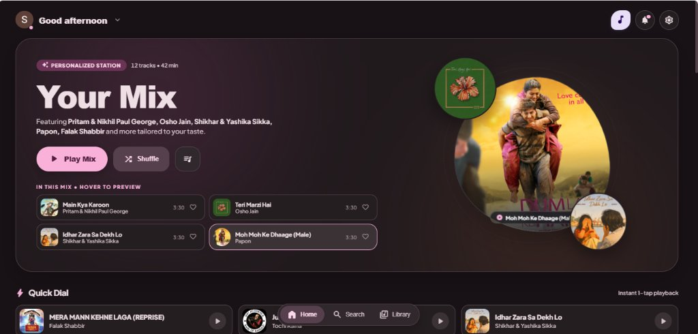
</p>
<p align="center">
  <sub><strong>Your Mix Personalized Station</strong> — Orbiting pebble artwork cluster (<code>m3HeroPebbleDrift</code>), hover-to-preview track pills, 1-tap Quick Dial shelf, top-right Music/Video <strong>Mode Morph</strong> squircle, and the floating Material 3 glass navigation dock.</sub>
</p>

<br />

### Adaptive Material 3 Expressive Player Personas
Switch seamlessly between **8 bespoke player layouts** engineered with real-time HCT tonal extraction, GPU ambient mist, and interactive acoustic scrubbers:

<table>
  <tr>
    <td width="50%" valign="top">
      <p align="center">
        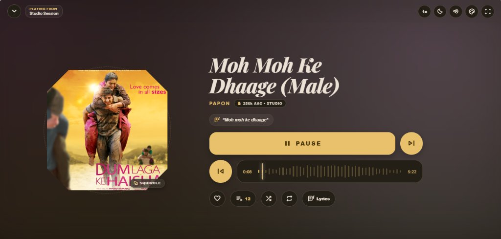
      </p>
      <p align="center">
         <strong>Editorial Persona</strong><br />
        <sub>Two-tone magazine spread with <em>Playfair Display</em> italic serif headers, 5-shape die-cut artwork morphing (<code>Squircle</code>, <code>Cookie</code>, <code>Gem</code>, <code>Arch</code>, <code>Octagon</code>), studio bitrate telemetry, and magnetic sonic waveform scrubber.</sub>
      </p>
    </td>
    <td width="50%" valign="top">
      <p align="center">
        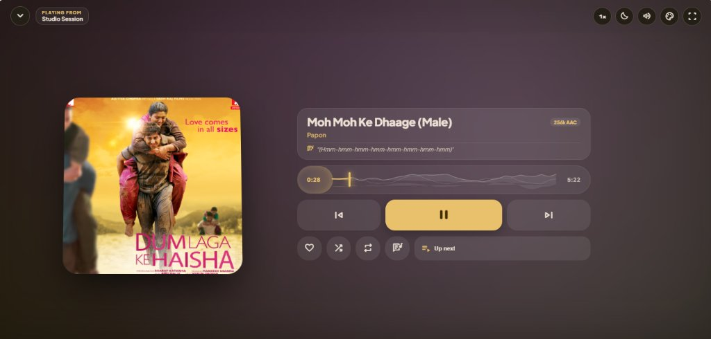
      </p>
      <p align="center">
         <strong>Bento Persona</strong><br />
        <sub>Modular tonal tile architecture featuring a live multi-layered <strong>Topographical Horizon Waveform</strong> scrubber, inline synced lyric preview ribbon, and split physical-mass transport tiles.</sub>
      </p>
    </td>
  </tr>
  <tr>
    <td width="50%" valign="top">
      <p align="center">
        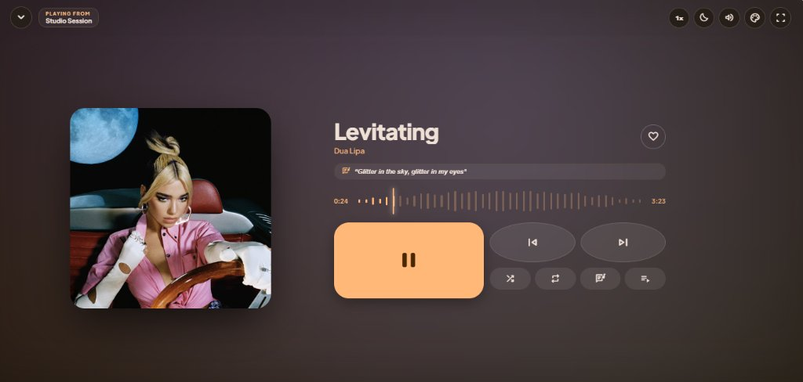
      </p>
      <p align="center">
         <strong>Hero Persona</strong><br />
        <sub>Widescreen tonal control deck with an oversized tactile pause squircle, pill-shaped skip cluster, elastic bar waveform scrubber, and high-contrast dynamic palette extraction.</sub>
      </p>
    </td>
    <td width="50%" valign="top">
      <p align="center">
        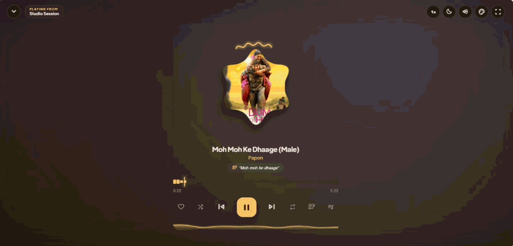
      </p>
      <p align="center">
         <strong>Morph Persona</strong><br />
        <sub>Center-stage 72-point cubic-bezier scalloped artwork continuously morphing across 5 M3 Expressive silhouettes inside a 26-ripple serpentine progress ring and bottom acoustic equalizer wave.</sub>
      </p>
    </td>
  </tr>
</table>


##  Why OurTube?

| Conventional Web Clients | OurTube Studio |
| :--- | :--- |
|  Requires Google Cloud Data API v3 keys with strict daily quotas |  **Zero API Keys**: Direct authenticated InnerTube streaming via local MV3 bridge |
|  Routed through slow, rate-limited third-party proxy servers |  **Zero Cloud Proxies**: Direct browser-to-YouTube network path with zero middlemen |
|  Static, flat template UI with hardcoded dark/light colors |  **Material 3 Expressive**: Real-time HCT tonal schemes, die-cut morphing &amp; spring physics |
|  Single-source line-by-line lyrics that frequently fail to match |  **15-Provider Kinetic Lyrics Cascade**: Word-by-word &amp; syllable TTML/LRC with duet alignment |
|  Audio-only playback or unstyled iframe video embeds |  **16 WebGL2 Video Shaders + SponsorBlock**: 60fps GLSL post-processing &amp; auto-skip segments |
|  Requires external desktop helper apps for Discord Rich Presence |  **Native MV3 Discord Gateway**: Built-in WebSocket Rich Presence directly from the browser |
|  Cloud telemetry, analytics beacons, and remote taste profiling |  **100% On-Device IndexedDB**: Listening stats, history, and taste profile never leave your machine |


##  Core Capabilities

### 1.  Dual-Engine Zero-API-Key Streaming
- **Native InnerTube Integration**: Streams high-bitrate audio (`256kbps AAC` / `Opus`) and adaptive video directly from official YouTube infrastructure.
- **Chromium MV3 Companion Bridge**: Authorizes requests locally using your browser's active Google session (`SAPISIDHASH`) and strips cross-origin restrictions via `declarativeNetRequest` rules.
- **Live Onboarding Gate**: If the companion extension is not yet loaded, OurTube displays an interactive stepper with a 1-click `ourtube-companion.zip` bundle and unlocks automatically the instant the extension handshakes.

### 2.  Unified Music &amp; Cinema Mode Morphing
- **Tactile Mode Morph Button**: Located in the top app bar, the [`ModeMorphButton`](apps/web/src/components/layout/ModeMorphButton.tsx) executes a 90-degree spring rotation morphing between a soft lavender flower squircle (Music Mode) and a pastel rose cookie squircle (Video Mode).
- **Dedicated Cinema Workspace**: Switching to Video Mode transforms the application into a full YouTube video client complete with a **Subscriptions Creator Avatar Rail**, **Cinema Watch Stage**, synchronized **Video Chapters**, **Live Captions**, **Comments Sheet**, and **Channel Drawer**.

### 3.  8 Adaptive Player Personas
Switch player architectures on the fly via the Player Style Gallery ([`PlayerStyleCatalog.ts`](apps/web/src/components/player/styles/PlayerStyleCatalog.ts)):

| Persona | Die-Cut Shape | Architectural Signature |
| :--- | :--- | :--- |
|  **Editorial** | `Flower / 5-Shape` | Two-tone magazine spread with *Playfair Display* serif headers, 3D pointer tilt, and sonic bar waveform |
|  **Bento** | `Cookie Squircle` | Modular frosted tonal tiles with a multi-layered **Topographical Horizon Waveform** and live lyric ribbon |
|  **Hero** | `Hero Squircle` | Widescreen tonal deck pairing an oversized tactile play/pause squircle with oval transport pills |
|  **Morph** | `72-Pt Polar Blob` | Living scalloped artwork cycling 5 M3 Expressive shapes inside a 26-ripple serpentine ring + bottom wave |
|  **Classic** | `Pure Circle` | Tactile hi-fi circular scrubber with physical-feel rotary geometry and clean studio focus |
|  **Canvas** | `Diamond Gem` | Full-bleed edge-sampled artwork immersion with floating glassmorphic controls |
|  **Gesture** | `Capsule Pill` | Compact, swipe-first expansive artwork carousel tailored for touch and narrow viewports |
|  **Dial** | `360° Chronograph` | Precision radial chronograph gauge with angular tick marks and rotational scrubbing |

### 4.  Koda WebGL2 Video Shader Studio &amp; SponsorBlock

<p align="center">
  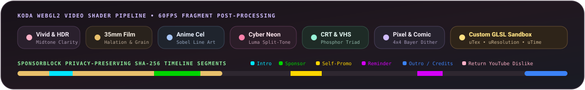
</p>

- **16 Real-Time GLSL Fragment Presets** ([`videoShaderStore.ts`](apps/web/src/store/videoShaderStore.ts)):
  - **Color Grades**: `Original`, `Vivid` (skin-safe vibrance boost), `Clarity` (local midtone HDR separation), `Film` (teal shadows, warm halation &amp; grain), `Noir` (red-filter monochrome &amp; vignette), `Anime` (ink line-art reconstruction &amp; cel shading), `Neon` (violet/magenta/cyan luminance split), `Dream` (13-tap soft highlight bloom).
  - **Physical Mediums**: `Vintage` (18fps gate weave &amp; scratches), `VHS` (chroma smear &amp; tracking noise), `CRT` (curved glass tube &amp; RGB phosphor triad), `Pixel` (160-col console blocks with 4x4 Bayer dithering), `Comic` (45-degree halftone dots &amp; Sobel ink), `Sketch` (cross-hatched graphite on paper), `Night Vision` (green phosphor intensifier).
  - **Custom GLSL Sandbox**: Write and compile your own per-frame fragment shaders live with `uTex`, `vTexCoord`, `uResolution`, and `uTime` uniforms plus 5 starter templates, paired with hardware `Sharpness`, `Contrast`, `Brightness`, and `Saturation` sliders.
- **Privacy-Preserving SponsorBlock &amp; Return YouTube Dislike** ([`sponsorBlockAndDislikes.ts`](apps/web/src/api/sponsorBlockAndDislikes.ts)):
  - Queries `sponsor.ajay.app` using only a **4-hex-character SHA-256 video ID prefix** so your exact watch activity is never exposed.
  - Renders color-coded timeline segments and optional auto-skip across 8 categories (`Sponsor`, `Self Promo`, `Interaction`, `Intro`, `Outro`, `Recap`, `Off-topic`, `Filler`), alongside live community dislike counts.

### 5.  15-Provider Multi-Source Kinetic Lyrics Cascade
- **Intelligent Priority Waterfall** ([`lyrics/sources.ts`](apps/web/src/lyrics/sources.ts)): Automatically resolves the highest-precision synchronized lyrics across **15 providers** in customizable priority order:
  1. `lrc.red` (Word-synced TTML)
  2. `BiniLyrics` (ISRC-matched word-synced TTML)
  3. `BetterLyrics` (Apple Music word-by-word)
  4. `BetterLyrics Portato` (QQ Music word-by-word)
  5. `PaxSenix Apple Music` (Syllable-timed TTML via Extension)
  6. `PaxSenix Spotify` &amp; `7. PaxSenix Musixmatch`
  8. `LyricsPlus` (Community syllable-by-syllable sync with multi-mirror failover)
  9. `Unison` (Enhanced word-synced LRC/TTML)
  10. `YouTube Captions` &amp; `11. YouTube Music` (Native InnerTube transcript &amp; shelf fallback)
  12. `KuGou` (Synced LRC with automatic credit stripping)
  13. `LRCLIB`, `14. Musixmatch RichSync`, and `15. Genius`
- **Apple Music Choreography**: Sub-second word-by-word glow interpolation, automatic **duet singer left/right alignment** (`start` / `end`), animated instrumental gap dots, Romanization support, and 1-click syllable seeking.

### 6.  BitChord 3-Tier Queue Timeline
- **Tier 1 — Up Next (User Enqueued)**: Manually queued tracks pinned to play immediately next with drag-and-drop reordering.
- **Tier 2 — Context Station**: The active album, playlist, or personalized mix currently anchored to your session.
- **Tier 3 — Continuous Discovery**: Seamless acoustic radio recommendations fetched automatically so playback never hits a dead end.

### 7.  Native Discord Rich Presence &amp; Multi-Account Switcher
- **Extension-Native Discord Gateway** ([`discordPresence.ts`](apps/web/src/api/discordPresence.ts)): Publishes rich presence activity (`Listening`, `Playing`, `Watching`, `Competing`), live elapsed/remaining timestamps, high-res album artwork, and custom action buttons directly through the MV3 extension — **zero desktop RPC helper binaries required**. Includes a live `DiscordPreviewCard` and 1-tap Incognito mode.
- **Multi-Account &amp; Brand Channel Switcher**: Automatically detects all Google accounts and YouTube Brand Channels in your session for instant identity switching and library re-indexing.


##  Material 3 Expressive Design System

<p align="center">
  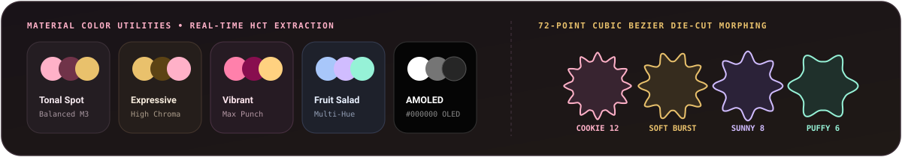
</p>

OurTube implements Google's **Material Design 3 Expressive** specification across color, shape, typography, and motion ([`tokens.css`](apps/web/src/theme/tokens.css)):

- **Dynamic HCT Tonal Palettes**: Extracts seed colors from the active track's artwork via `@material/material-color-utilities` and maps full `--md-sys-color-*` tonal pairs (`primary`, `on-primary`, `primary-container`, `surface-container-lowest` through `surface-container-highest`, `outline-variant`) across **5 algorithmic styles** (*Tonal Spot*, *Expressive*, *Vibrant*, *Fruit Salad*, *Monochrome*) plus **AMOLED Pure `#000000` Mode**.
- **72-Point Polar Fourier Shape Morphing**: [`M3ExpressiveMorphHero.tsx`](apps/web/src/components/player/M3ExpressiveMorphHero.tsx) computes smooth closed cubic-bezier SVG paths (`r(θ) = R₀ + a₁cos(nθ) + a₂cos(2nθ)`) that morph at 60fps across `Cookie12Sided`, `SoftBurst`, `Sunny`, `Puffy`, and `Cookie9Sided`.
- **Spring-Physics Motion Tokens**: Replaces linear transitions with expressive spatial springs (`--m3-spring-spatial-default: cubic-bezier(0.34, 1.56, 0.64, 1.0)`, `--m3-spring-spatial-fast: cubic-bezier(0.38, 1.21, 0.22, 1.0)`) driving tactile button compression, heart-burst particle pops (`m3HeartBurst`), and shared-axis view transitions, while fully honoring `prefers-reduced-motion`.


##  System Architecture

<p align="center">
  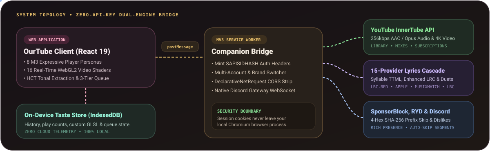
</p>


##  Getting Started

### Prerequisites
- **Node.js**: `v18.0.0` or higher
- **Package Manager**: `npm` (`v9+`)
- **Browser**: Google Chrome, Brave, Microsoft Edge, Arc, or any Chromium browser supporting Manifest V3

### 1. Clone &amp; Install Dependencies
```bash
git clone https://github.com/Marvelousshivam/OurTube.git
cd OurTube

# Install dependencies across all monorepo workspaces
npm install
```

### 2. Build Companion Extension &amp; Web Bundle
```bash
npm run build
```
Compiles the Chromium MV3 extension into [`apps/extension/dist`](apps/extension), packages the 1-click `ourtube-companion.zip` bundle, and builds the production web client.

### 3. Load the Companion Extension
1. Open your Chromium browser and navigate to `chrome://extensions` (or `brave://extensions`, `edge://extensions`).
2. Enable **Developer mode** in the top-right corner.
3. Click **Load unpacked** and select:
   ```text
   <repo-root>/apps/extension/dist
   ```
4. Confirm that **OurTube Companion Extension** is enabled.

> [!TIP]
> You can also run `npm run dev` right away and download `ourtube-companion.zip` directly from the interactive onboarding screen inside the web app.

### 4. Launch Development Server
```bash
npm run dev
```
Open `http://localhost:5173`. The web client will automatically handshake with the companion extension over `window.postMessage` and unlock your personal YouTube Music &amp; Cinema library.


##  Keyboard Shortcuts

Press <kbd>?</kbd> anywhere in the application to open the interactive Keyboard Shortcuts modal ([`useKeyboardShortcuts.ts`](apps/web/src/hooks/useKeyboardShortcuts.ts)).

| Shortcut | Action |
| :---: | :--- |
| <kbd>Space</kbd> / <kbd>K</kbd> | Toggle Play / Pause |
| <kbd>&larr;</kbd> / <kbd>&rarr;</kbd> | Seek `5s` backward / forward |
| <kbd>J</kbd> / <kbd>L</kbd> | Seek `10s` backward / forward |
| <kbd>&uarr;</kbd> / <kbd>&darr;</kbd> | Adjust Volume `+5%` / `-5%` |
| <kbd>M</kbd> | Toggle Audio Mute |
| <kbd>C</kbd> / <kbd>Alt</kbd> + <kbd>L</kbd> | Toggle Kinetic Lyrics Sheet |
| <kbd>Q</kbd> | Toggle 3-Tier Queue Sheet |
| <kbd>N</kbd> / <kbd>P</kbd> | Skip to Next / Previous Track |
| <kbd>S</kbd> / <kbd>R</kbd> | Cycle Shuffle / Repeat Mode |
| <kbd>H</kbd> | Like / Favorite Active Track |
| <kbd>F</kbd> | Toggle Fullscreen Stage Mode |
| <kbd>?</kbd> | Open Keyboard Shortcuts Cheat Sheet |
| <kbd>Esc</kbd> | Collapse Expanded Player / Dismiss Active Sheet |


##  Tech Stack &amp; Privacy Guarantees

| Layer | Technologies |
| :--- | :--- |
| **Frontend Runtime** | [React 19](https://react.dev/), [TypeScript 5.7](https://www.typescriptlang.org/), [Vite 6](https://vitejs.dev/) |
| **Design System** | [Material Design 3 Expressive](https://m3.material.io/), [`@material/web`](https://github.com/material-components/material-web), [`@material/material-color-utilities`](https://github.com/material-foundation/material-color-utilities) |
| **State &amp; Storage** | [Zustand 5](https://github.com/pmndrs/zustand), On-Device [IndexedDB](https://developer.mozilla.org/en-US/docs/Web/API/IndexedDB_API) via [`idb`](https://github.com/jakearchibald/idb) |
| **Video &amp; Audio Engine** | WebGL2 Fragment Shader Pipeline, HTML5 Audio/Video MSE, `SAPISIDHASH` InnerTube Stream Resolver |
| **Lyrics &amp; Metadata** | 15-Source Cascade (`lrc.red`, `BiniLyrics`, `BetterLyrics`, `PaxSenix`, `LyricsPlus`, `Unison`, `LRCLIB`, `KuGou`, `Musixmatch`), SponsorBlock SHA-256 Prefix API |
| **Companion Bridge** | Chromium Manifest V3 Service Worker, `declarativeNetRequest`, Native Discord Gateway WebSocket |
| **Typography &amp; Icons** | *Plus Jakarta Sans*, *Playfair Display*, *Roboto Flex*, *Material Symbols Rounded* |

> [!IMPORTANT]
> **100% Local Credential &amp; Taste Isolation**: Your Google session cookies never leave your browser process. The MV3 Companion Extension mints `SAPISIDHASH` authorization headers locally in memory, and your listening history, play counts, and custom shaders are stored exclusively in your browser's local `IndexedDB`.

---

<div align="center">
  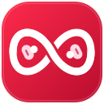
  <br />
  <sub>Distributed under the <a href="LICENSE"><strong>MIT License</strong></a> &bull; Crafted with Material Design 3 Expressive</sub>
</div>
