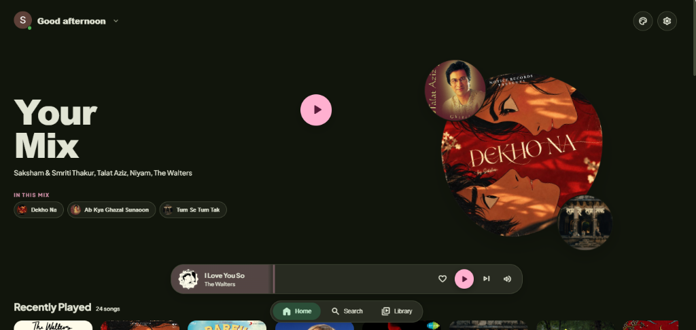
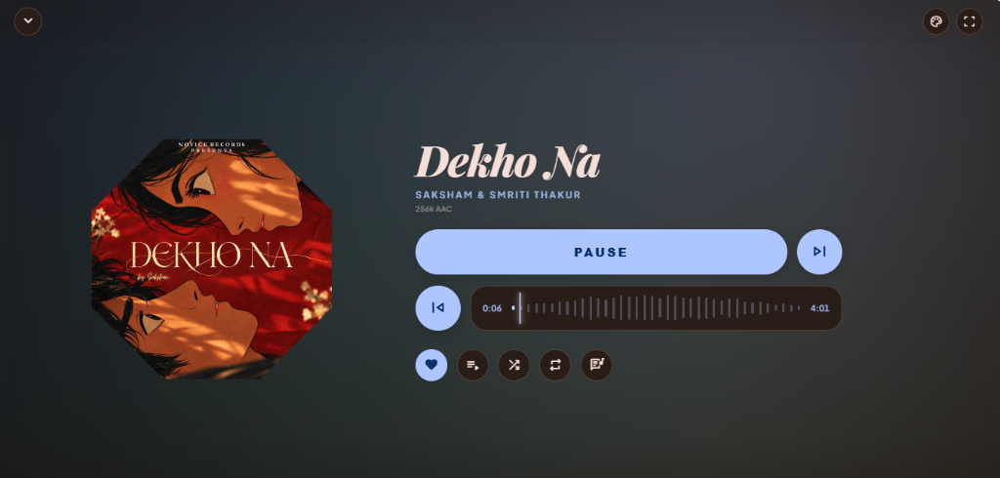
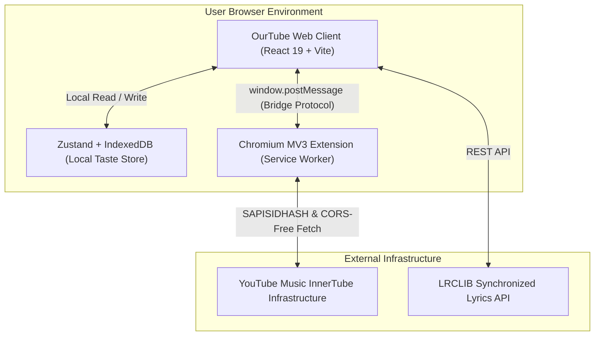

<div align="center">

# OurTube 🎵🎬

### *A Material 3 Expressive YouTube Music Client for the Modern Web.*

<p align="center">
  Zero Cloud Proxies • Zero API Keys • Real-time Tonal Colors • Apple Music Kinetic Lyrics • BitChord 3-Tier Queue
</p>

<div align="center">
  
  
  
  
  
  
</div>

<br />

<p align="center">
  
</p>
<p align="center">
  <em>The living "Your Mix" organic hero deck, floating navigation dock, and Recently Played shelf with dynamic M3 tonal pairing.</em>
</p>

<br />

<p align="center">
  
</p>
<p align="center">
  <em>The Editorial Player persona: 12-sided scalloped die-cut artwork, magnetic sonic waveform scrubber, and real-time GPU Chromatic Mist ambient canvas.</em>
</p>

</div>

---

## Table of Contents

- [Overview](#overview)
- [Why OurTube?](#why-ourtube)
- [Core Features](#core-features)
  - [1. Dual-Engine Zero-API-Key Streaming](#1-dual-engine-zero-api-key-streaming)
  - [2. 5 Adaptive Player Personas](#2-5-adaptive-player-personas)
  - [3. Apple Music Word-by-Word Kinetic Lyrics](#3-apple-music-word-by-word-kinetic-lyrics)
  - [4. BitChord 3-Tier Queue Timeline](#4-bitchord-3-tier-queue-timeline)
  - [5. Material 3 Expressive Motion Physics](#5-material-3-expressive-motion-physics)
  - [6. Multi-Account & Brand Channel Switcher](#6-multi-account--brand-channel-switcher)
  - [7. Palette Studio & Dynamic Theming](#7-palette-studio--dynamic-theming)
  - [8. Privacy-First On-Device Taste Store](#8-privacy-first-on-device-taste-store)
- [System Architecture](#system-architecture)
- [Getting Started](#getting-started)
- [Keyboard Shortcuts](#keyboard-shortcuts)
- [Tech Stack](#tech-stack)
- [Security & Privacy](#security--privacy)
- [License](#license)

---

## Overview

**OurTube** is a personal, high-performance music application built with **React 19**, **Vite**, and **Google Material Design 3 Expressive**. 

Instead of relying on fragile cloud scrapers, third-party proxy servers, or rate-limited YouTube Data API v3 keys, OurTube implements a **Dual-Engine Architecture**: a modern single-page web app paired with a lightweight **Chromium Manifest V3 Companion Extension**. The extension acts as a seamless network bridge, authorizing requests via your browser's existing Google session (`SAPISIDHASH`) and stripping CORS restrictions on official YouTube Music endpoints.

The result is full, unthrottled access to the entire YouTube Music catalog, your personal listening history, liked songs, and custom playlists — presented within an editorial interface inspired by high-fashion typography, physical audio equipment, and Google's latest Material 3 Expressive design tokens.

---

## Why OurTube?

| Traditional Web Clients | OurTube |
|:---|:---|
| ❌ Requires Google Cloud API keys with strict daily quotas | ✅ **Zero API keys**: Direct authenticated access to YouTube InnerTube |
| ❌ Routed through slow, privacy-invasive third-party proxies | ✅ **Local network bridge**: Direct communication between your browser and YouTube |
| ❌ Generic, template-driven UI with flat static layouts | ✅ **Material 3 Expressive**: Shape-morphing die-cuts, spring physics, and organic drift |
| ❌ Basic line-by-line lyrics with delayed sync | ✅ **Apple Music kinetic lyrics** with sub-second word-by-word interpolation |
| ❌ Single flat playlist queue | ✅ **BitChord 3-tier queue timeline**: Up Next, Context Radio & AI Recommendations |
| ❌ Cloud telemetry and user tracking | ✅ **100% on-device IndexedDB privacy**: Your listening taste never leaves your machine |

---

## Core Features

### 1. Dual-Engine Zero-API-Key Streaming
- **Native InnerTube Integration**: Streams high-bitrate audio (256kbps AAC / Opus) directly from YouTube infrastructure.
- **Chromium MV3 Extension Bridge**: Injects authentic session tokens (`SAPISIDHASH`) and utilizes declarative net request rules to bypass browser cross-origin restrictions cleanly.
- **BitChord-Style Hard Gate**: If the companion extension is not detected, OurTube presents a step-by-step onboarding walkthrough and a 1-click zip bundle download. Detection is live and unlocks the application instantly upon extension load.

### 2. 5 Adaptive Player Personas
Customize how you experience your music with one click:
- 📖 **Editorial**: High-fashion magazine spread featuring Playfair Display typography, 12-sided scalloped die-cut artwork morphing, and asymmetric metadata bento cards.
- 🍱 **Bento**: An information-dense modular grid featuring quick controls, technical audio telemetry (bitrate, codecs, volume levels), and utility chips.
- 📻 **Classic**: Minimalist physical-feel hi-fi player with tactile circular knobs, physical toggles, and clean focus.
- 🎨 **Canvas**: Fullscreen immersive artwork experience with floating glass controls and seamless background integration.
- 📱 **Gesture**: Compact, swipe-first deck built for mobile devices and small viewports.

### 3. Apple Music Word-by-Word Kinetic Lyrics
- **Sub-Second Synchronization**: Powered by `@uimaxbai/am-lyrics` and LRCLIB, lyrics animate word-by-word with staggered line motion.
- **Interactive Karaoke Navigation**: Tap or click any lyric line to jump the audio playback directly to that exact syllable.
- **Dynamic Background Tint**: Lyrics canvas subtly blooms with colors extracted from the active album cover.

### 4. BitChord 3-Tier Queue Timeline
Inspired by the queue architecture of BitChord:
- **Tier 1 — Up Next (User Enqueued)**: Songs manually added to play next, with instant drag-and-drop reordering.
- **Tier 2 — Context Station**: The album, playlist, or artist radio currently being listened to.
- **Tier 3 — Continuous Recommendations**: Algorithmic infinite discovery songs based on your session's acoustic fingerprint.

### 5. Material 3 Expressive Motion Physics
- **Living Hero Deck**: The pebble artwork and satellite circles in *Your Mix* continuously float and breathe (`m3HeroPebbleDrift`), responding dynamically to mouse depth.
- **Live 4-Bar Equalizer Waves**: Active playing songs display a fluid 4-bar equalizer oscillating at asynchronous frequencies, replacing static icons.
- **Liquid Magnetic Waveform Scrubber**: Hovering or scrubbing across the audio waveform creates an elastic proximity wave under the pointer.
- **Shared Axis View Transitions**: Smooth 280ms cross-axis slides between Home, Search, Library, and drill-down pages.
- **Tactile Springs**: Heart burst particle pops (`m3HeartBurst`), button compression gives, and navigation pill sliding.

### 6. Multi-Account & Brand Channel Switcher
- Automatically resolves all Google accounts and YouTube brand channels associated with your browser session.
- Switch active channel identities on the fly with immediate library re-indexing.

### 7. Palette Studio & Dynamic Theming
- **Dynamic Color Extraction**: Generates full Material 3 tonal palettes directly from the current song's artwork using `@material/material-color-utilities`.
- **5 Algorithm Styles**:
  - *Tonal Spot*: Balanced, natural Material You tones.
  - *Expressive*: High-chroma complementary accents with vibrant warmth.
  - *Vibrant*: Maximum saturation for bold, punchy contrast.
  - *Fruit Salad*: Playful multi-hue tonal variations.
  - *Monochrome*: Pure grayscale minimalism.
- **AMOLED Pure Black Mode**: True `#000000` pitch black background for OLED screens with high-contrast tonal surfaces.

### 8. Privacy-First On-Device Taste Store
- **Local IndexedDB Engine**: Stores recent plays, completion percentages, search history, and favorite tracks on your device.
- **Zero Telemetry**: No third-party trackers, analytics scripts, or cloud databases.

---

## System Architecture



---

## Getting Started

### Prerequisites
- **Node.js**: v18.0.0 or higher
- **Package Manager**: `npm` (v9+)
- **Browser**: Google Chrome, Brave, Microsoft Edge, or any Chromium-based browser supporting Manifest V3.

### 1. Clone & Install
```bash
git clone https://github.com/Marvelousshivam/OurTube.git
cd OurTube

# Install dependencies across all monorepo workspaces
npm install
```

### 2. Build Extension & Web App
```bash
npm run build
```
This builds the Chromium extension to `apps/extension/dist`, generates the packaged `ourtube-companion.zip`, and compiles the web bundle.

### 3. Load the Companion Extension
1. Open your browser and navigate to `chrome://extensions` (or `brave://extensions`, `edge://extensions`).
2. Enable **Developer mode** in the top-right corner.
3. Click **Load unpacked** and select:
   ```
   <repo-root>/apps/extension/dist
   ```
4. Verify that **OurTube Companion Extension** is visible and active.

> [!TIP]
> You can also launch the web app directly without building the extension manually; the on-screen gate provides a one-click download of `ourtube-companion.zip` ready to extract and load.

### 4. Run Development Server
```bash
npm run dev
```
Navigate to `http://localhost:5173` in your browser. The bridge client will automatically handshake with the companion extension and unlock the complete interface!

---

## Keyboard Shortcuts

OurTube features comprehensive desktop keyboard navigation. Press `?` anytime inside the app to open the cheat sheet modal.

| Shortcut | Action |
|:---:|:---|
| <kbd>Space</kbd> / <kbd>K</kbd> | Toggle Play / Pause |
| <kbd>←</kbd> / <kbd>→</kbd> | Seek 5 seconds backward / forward |
| <kbd>J</kbd> / <kbd>L</kbd> | Seek 10 seconds backward / forward |
| <kbd>↑</kbd> / <kbd>↓</kbd> | Adjust Volume up / down (+5% / -5%) |
| <kbd>M</kbd> | Toggle Mute |
| <kbd>C</kbd> | Toggle Synced Lyrics Sheet |
| <kbd>Q</kbd> | Toggle Up Next Queue Sheet |
| <kbd>N</kbd> / <kbd>P</kbd> | Skip to Next / Previous track |
| <kbd>S</kbd> / <kbd>R</kbd> | Toggle Shuffle / Repeat mode |
| <kbd>H</kbd> | Like / Favorite current track |
| <kbd>F</kbd> | Toggle Fullscreen Stage Mode |
| <kbd>?</kbd> | View Keyboard Shortcuts Modal |
| <kbd>Esc</kbd> | Collapse Expanded Player / Close Modals |

---

## Tech Stack

| Layer | Technologies |
|:---|:---|
| **Core Framework** | [React 19](https://react.dev/), [TypeScript 5.7](https://www.typescriptlang.org/), [Vite 6](https://vitejs.dev/) |
| **Design System** | Google [Material 3 Expressive](https://m3.material.io/), [`@material/web`](https://github.com/material-components/material-web), [`@material/material-color-utilities`](https://github.com/material-foundation/material-color-utilities) |
| **State Management** | [Zustand 5](https://github.com/pmndrs/zustand) |
| **Local Database** | [IndexedDB](https://developer.mozilla.org/en-US/docs/Web/API/IndexedDB_API) via [`idb`](https://github.com/jakearchibald/idb) |
| **Lyrics Engine** | [`@uimaxbai/am-lyrics`](https://github.com/uimaxbai/am-lyrics), [LRCLIB](https://lrclib.net/) |
| **Streaming & Auth** | [`youtubei.js`](https://github.com/LuanRT/YouTube.js), Chromium Manifest V3 Background Service Worker |
| **Icons & Typography** | [Material Symbols Rounded](https://fonts.google.com/icons), Syne, Playfair Display, Plus Jakarta Sans |

---

## Security & Privacy

> [!NOTE]
> **Zero Remote Logging**: OurTube has no central tracking servers, telemetry services, or advertising beacons.

- **Session Security**: The companion extension reads session cookies locally to construct InnerTube headers (`SAPISIDHASH`). Your credentials never leave your browser process.
- **Safe Sandboxing**: Web pages communicate with the companion extension solely via structured `window.postMessage` contracts with type checking and origin validation.

---

## Contributing

Contributions are welcome! Please feel free to open an issue or submit a pull request.

1. Fork the Project
2. Create your Feature Branch (`git checkout -b feature/AmazingFeature`)
3. Commit your Changes (`git commit -m 'feat: Add AmazingFeature'`)
4. Push to the Branch (`git push origin feature/AmazingFeature`)
5. Open a Pull Request

---

## License

Distributed under the **MIT License**. See `LICENSE` for more information.

<div align="center">
  <sub>Crafted with passion for music, design craft, and user privacy.</sub>
</div>
